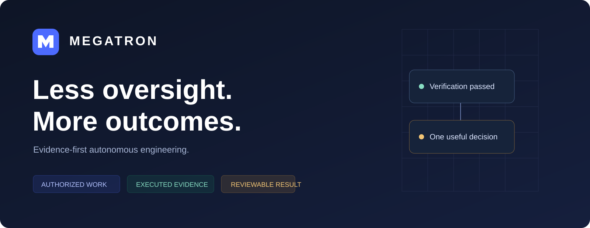
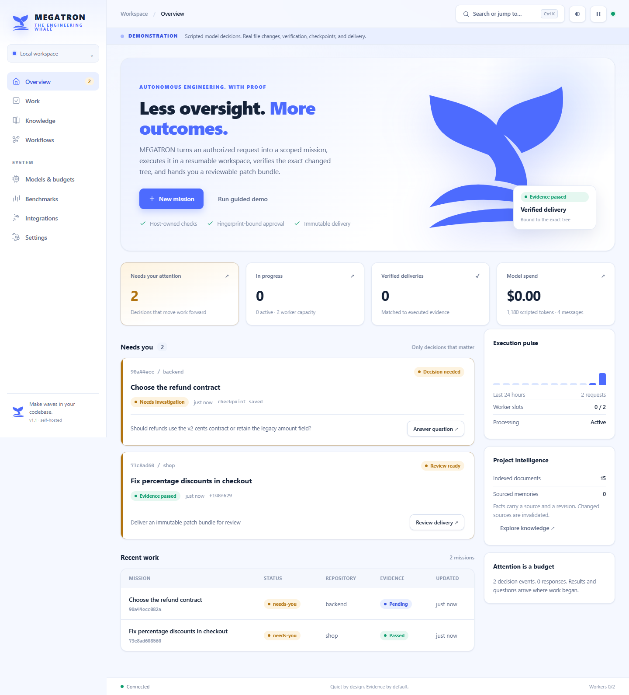
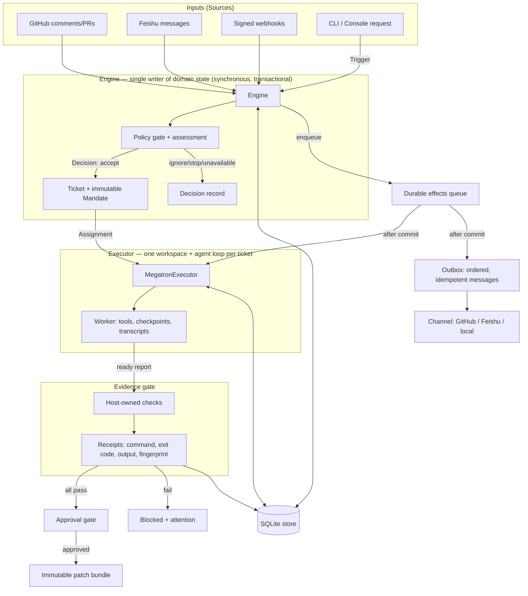
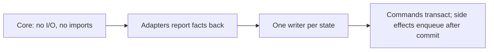

# MEGATRON

### Evidence-first autonomous engineering.



MEGATRON is a self-hosted engineering workbench that turns an authorized request into a scoped **mission**, executes it in a resumable workspace, **verifies the exact changed tree**, and delivers a reviewable patch bundle. The CLI, web console, and VS Code extension share one backend.

**Quiet by design. Evidence by default.**

<p>
<a href="#install">Install</a> ·
<a href="#how-to-use">How to use</a> ·
<a href="#architecture">Architecture</a> ·
<a href="#documentation">Docs</a>
</p>



---

## Why it is different

Most coding agents stop at *"I think it's done."* MEGATRON requires **evidence**:

- A worker's `ready` report is only a *request*. The host then runs the operator-approved acceptance checks itself.
- Every receipt records the exact command, exit code, output, environment, and a SHA-256 **fingerprint of the changed tree**.
- Approvals are bound to that fingerprint: if the code changes after verification, the approval is invalidated.
- Delivery writes an **immutable patch bundle** (`changes.patch`, `manifest.json`, a full tree snapshot, receipts) — it never silently merges a remote branch.

---

## Install

**Prerequisite: Node.js 24 or newer.** MEGATRON's engine, CLI, store, and console use only Node's built-in modules (including the native `node:sqlite` and built-in TypeScript support). There is no build step and no core runtime dependency.

```powershell
git clone https://github.com/ibrahim-hero/MEGATRON.git
cd MEGATRON
```

That is enough to run everything. To run the **tests and the optional browser tooling**, install the dev dependencies:

```powershell
npm.cmd ci
# On macOS/Linux:  npm ci
```

Optional extras:

| To do this | Install |
| --- | --- |
| Browser end-to-end tests / native `browser_inspect` tool | `npm.cmd run test:e2e` (Windows uses installed Edge; elsewhere run `npx playwright install chromium`) |
| Real model inference | Set a provider key in your terminal (see below) |
| Container execution | Docker, then `docker pull node:24-bookworm-slim` |
| GitHub / Feishu sources | `gh` and `lark-cli` on your `PATH`, signed in |

Verify the checkout before you trust it:

```powershell
npm.cmd run check        # typecheck + 41 unit tests
node demo/run-demo.mjs   # full end-to-end demonstration
```

---

## How to use

### 1. Run the demonstration (no API key needed)

```powershell
node bin/mg.js serve --demo
```

Open **http://127.0.0.1:3082**. The demo contains a real checkout regression fix and a structured product question. Review the change and its executed evidence, then approve the patch bundle.

For a terminal-only run:

```powershell
node demo/run-demo.mjs
```

Demo *decisions* are explicitly scripted, but **files really change, tests really execute, failed checks really block delivery, and checkpoints/receipts really persist**. See `demo/output/` for the timeline, evidence, and patch artifacts.

### 2. Point it at your own repository and model

```powershell
# 1. Create the persistent workspace config
node bin/mg.js init

# 2. Register a repository and its acceptance check
node bin/mg.js repo add shop "G:\src\shop" --verify "node --test test/cart.test.js"

# 3. Connect a model. Keys stay in your terminal — never in settings.json.
$env:OPENAI_API_KEY = "your-key"
node bin/mg.js model add main --provider openai --model YOUR_MODEL --key-env OPENAI_API_KEY

# Anthropic and OpenAI-compatible local servers work the same way:
$env:ANTHROPIC_API_KEY = "your-key"
node bin/mg.js model add reviewer --provider anthropic --model YOUR_MODEL --key-env ANTHROPIC_API_KEY

# 4. Start a mission
node bin/mg.js run "Fix checkout discounts; preserve the existing regression tests" --repo shop
```

Then work it from the CLI:

```powershell
node bin/mg.js ls                       # list missions and stages
node bin/mg.js show <id>                # scope, mandate, assignments, evidence, costs
node bin/mg.js watch <id>               # follow until a decision or delivery
node bin/mg.js diff <id>                # actual before/after change set
node bin/mg.js replay <id>              # the factual event timeline
node bin/mg.js ask <id> "use the v2 contract"   # answer / steer
node bin/mg.js approve <id>             # create the immutable patch bundle
node bin/mg.js deny <id> "cover rounding"       # request changes
node bin/mg.js stop <id>                # withdraw the mandate
node bin/mg.js retry <id>               # retry blocked/failed work
```

Add `--json` to any command for structured output.

### 3. Use the console, CLI, IDE, and mobile surface

- **Console** — `node bin/mg.js serve`, then open http://127.0.0.1:3082. Attention-first overview, mission timelines, evidence drawers, review dialogs, knowledge search, benchmarks, and versioned settings. Toggle dark/light; `Ctrl+K` opens the command palette.
- **CLI** — `node bin/mg.js --help` for the full command tree (run, ls, show, watch, ask, approve, deny, stop, retry, action, bench, knowledge, workflow, skill, plugin, mcp, settings).
- **VS Code** — install the `.vsix` from the [latest release](https://github.com/ibrahim-hero/MEGATRON/releases), point `megatron.url` at your server, and review/approve missions in the MEGATRON activity-bar view.
- **Mobile** — the console ships a web-app manifest; add it to your home screen. For LAN access set `MEGATRON_SERVER_TOKEN` and run `serve --host 0.0.0.0`.

### 4. Scoped delivery actions

A verified bundle does not merge itself. Request a separate, reviewable action:

```powershell
node bin/mg.js action <id> apply        # apply the bundle to the local repo
node bin/mg.js action <id> publish-pr   # open a GitHub PR via the Git data API
node bin/mg.js action <id> merge        # merge with head/approval/CI/size checks
node bin/mg.js approve <id>             # each action creates its own gate
```

See [docs/USAGE.md](docs/USAGE.md) for deployment/rollout actions, budgets, sandboxes, knowledge, skills, and recovery. The full command reference, provider setup, and security notes live there too.

---

## Architecture

MEGATRON is a small, layered system. The **core owns facts**; everything external is a port. The core never runs a shell, calls a model, or sends a remote message — adapters do that and report results back.



### Layers

| Layer | Modules | Responsibility |
| --- | --- | --- |
| **Core (pure facts)** | `src/core/model.ts`, `ports.ts`, `stage.ts` | Typed domain types and port interfaces. No I/O. |
| **Engine** | `src/engine.ts`, `src/policy.ts`, `src/evidence.ts` | Single writer of tickets/decisions; the authorization gate; the evidence rule. All commands synchronous. |
| **Store** | `src/store/store.ts` | SQLite aggregate records, FTS5 knowledge, append-only event log, **leased effect queue**, nested transactions. |
| **Effects & Outbox** | `src/effects.ts`, `src/outbox.ts` | Durable external work that runs *after* commit; ordered, idempotent channel receipts. |
| **Executor** | `src/executor/*`, `src/agent/*` | Per-ticket workspace and agent loop; tools; checkpoints; verification; artifact creation. |
| **Intelligence** | `src/knowledge/`, `src/app/model-router.ts`, `src/skills/`, `src/workflows/` | Cited project knowledge, capability/cost routing, validated skills, dependency-aware multi-repo work. |
| **Integrations** | `src/llm/`, `src/sandbox/`, `src/sources/`, `src/plugins/` | Model providers, execution sandboxes, GitHub/Feishu/webhook sources, pinned plugins, MCP. |
| **Surfaces** | `src/cli/mg.ts`, `src/app/server.ts`, `web/`, `extensions/vscode/` | CLI, HTTP API + console, VS Code extension — all over the same API. |

### Design rules



- **One writer per state.** The Engine alone writes tickets/assignments/decisions. Sources write only their own cursors and thread metadata.
- **Facts, then effects.** A command changes aggregates inside one transaction and *queues* external work. Effects run only after commit; a failed run retries with backoff and a lease, and survives restarts.
- **Authorization in code, not prompts.** The Policy gate and immutable Mandate decide who may originate work and how far it may go. Prompt text cannot change this.
- **Recovery over repetition.** Workspaces are preserved, transcripts and tool receipts are stored, and an interrupted external action asks the worker to reconcile rather than blindly repeat.

Read [docs/ARCHITECTURE.md](docs/ARCHITECTURE.md) for the composition root, recovery model, and adaptation points, and [docs/IMPLEMENTATION.md](docs/IMPLEMENTATION.md) for the plan-to-code traceability.

---

## The twelve-capability implementation

| Capability | Runnable implementation |
| --- | --- |
| Benchmark and evaluations | Five regression fixtures, adversarial false-ready rejection, trace export, configured-provider runs, CI |
| Cost and attention accounting | Per-mission tokens, configured-price cost, wall time, messages, decisions, and human inputs |
| Evidence-backed completion | Host-owned checks, red/green regression receipts, immutable check files, fingerprint-bound approval |
| Durable checkpoints | Per-step transcripts, tool receipts, resumable assignments, preserved workspaces |
| Approval gates | Delivery, local application, GitHub PR publication/merge, and deployment actions |
| Execution environments | Explicit local mode or a constrained Docker adapter; container mode never falls back silently |
| Project intelligence | SQLite FTS5, offline vectors, symbols/import graph, sourced facts, hash-based freshness |
| Coordinated work | Persisted dependency graphs, repository scopes, file contracts, conflict-aware scheduling |
| Routing and speculation | Capability/cost/outcome-based model routing; independently checked competing candidates |
| Validated learning | Versioned skills extracted from verified work; separate holdout validation before publication |
| Multiple repositories | Backend/client workstreams with dependent artifacts and separate mission mandates |
| Product surfaces | CLI, responsive dark/light console, VS Code review extension, installable mobile web surface, GitHub/Feishu/webhooks/MCP |

Measured rollout checks and declared rollback actions are available through deployment integrations. Native browser investigation captures local-app DOM content, failing requests, console errors, and screenshots.

---

## Verify it

```powershell
npm.cmd run check                                  # typecheck + 41 unit tests
npm.cmd run test:e2e                               # 6 real browser journeys
node bin/mg.js bench --demo --state tools/bench --json
```

The recorded run passed **41 unit tests**, **6 isolated browser scenarios**, **5/5 positive regression fixtures**, and the false-ready rejection (see [docs/VERIFICATION.json](docs/VERIFICATION.json)). The default scorecard measures the *harness* with declared scripts; use `bench --live` to measure your configured models on the same fixtures.

---

## Documentation

- [**Usage and setup**](docs/USAGE.md) — install, providers, repositories, missions, budgets, sandboxes, recovery
- [**Architecture and recovery**](docs/ARCHITECTURE.md) — layers, composition, evidence, restarts
- [Plan-to-code mapping](docs/IMPLEMENTATION.md) · [HTTP API](docs/API.md) · [Integrations & plugins](docs/INTEGRATIONS.md)
- [Testing](docs/TESTING.md) · [Product / UI / UX guide](docs/PRODUCT.md) · [Publishing](docs/PUBLISHING.md)
- [**PDF product guide**](docs/MEGATRON-Product-Guide.pdf) · [original planning PDF](docs/MEGATRON-Original-Plan.pdf)
- [Screenshots](assets/screenshots/) · [walkthrough video](assets/demo/megatron-walkthrough.webm) · [VS Code extension](extensions/vscode/README.md)

Build distributable archives:

```powershell
npm.cmd run package
# releases/MEGATRON-v1.1.0.zip
# releases/megatron-mission-control-1.1.0.vsix
# releases/SHA256SUMS.txt
```

---

## Design lineage

Inspired by the explicit domain model and attention philosophy of [dsh-superagent-prototype](https://github.com/ibrahim-hero/dsh-superagent-prototype). MEGATRON is an independent implementation with its own runtime and branding. It does not require DeepSeek Harness packages. The whale-tail silhouette used in the brand mark is adapted from [Game-Icons.net](https://game-icons.net/) under [CC BY 3.0](https://creativecommons.org/licenses/by/3.0/); see [asset attribution](assets/brand/ATTRIBUTION.txt).

MIT license. See [LICENSE](LICENSE).
